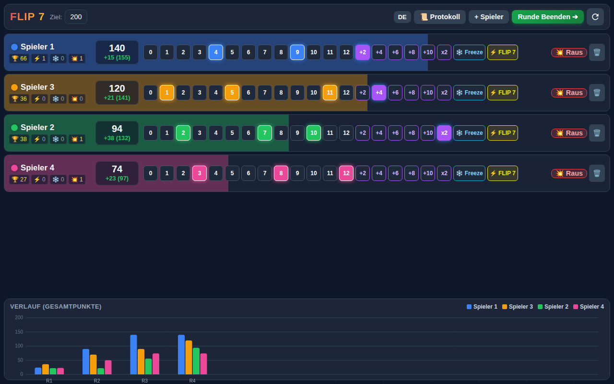
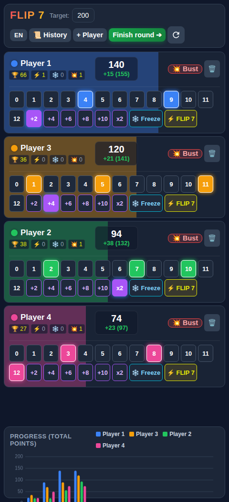

# Flip 7 Score Tracker / Flip 7 Punktezähler

[Deutsch](#deutsch) · [English](#english)

## Screenshots

| Tablet (DE) | Smartphone (EN) |
| --- | --- |
|  |  |

## Deutsch

Ein Punktezähler für das Kartenspiel **Flip 7**. Die Anwendung zeigt Spieler, Karten, Punkte und den Spielverlauf auf einer Seite. Das Layout ist für Tablets ausgelegt und lässt sich auch auf Smartphones verwenden.

### Starten

- **Online:** [Flip 7 über GitHub Pages öffnen](https://tprommi.github.io/flip7/)
- **Offline:** Dieses Repository herunterladen und `index.html` direkt im Browser öffnen. Eine Installation oder ein Webserver ist nicht erforderlich.

### Sprache

Mit dem **DE/EN-Button** zwischen Deutsch und Englisch wechseln. Der Button zeigt die aktuelle Sprache; die Auswahl wird im Browser gespeichert.

### Spielen

1. Bei Bedarf über **+ Spieler** Mitspielende hinzufügen und das Punkteziel auswählen.
2. Für jede Person die gezogenen Zahlen- und Sonderkarten antippen. Die Punkte der laufenden Runde werden direkt angezeigt.
3. Bei einem gescheiterten Zug die entsprechende Person als ausgeschieden markieren.
4. Mit **Runde Beenden** die Punkte übernehmen. Im **Protokoll** lassen sich vergangene Runden ansehen und korrigieren.
5. Über das Symbol für ein neues Spiel Punkte und Rundenverlauf zurücksetzen.

Die Seite zeigt außerdem den Verlauf der Gesamtpunkte als Diagramm. Spieler und Runden werden lokal im Browser gespeichert. Beim Löschen der Browserdaten oder beim Wechsel des Browsers stehen diese Daten dort nicht mehr zur Verfügung.

## English

A score tracker for the **Flip 7** card game. The app shows players, cards, scores, and game progress on a single page. Its layout is designed for tablets and also works on phones.

### Getting started

- **Online:** [Open Flip 7 on GitHub Pages](https://tprommi.github.io/flip7/)
- **Offline:** Download this repository and open `index.html` directly in a browser. No installation or web server is required.

### Language

Use the **DE/EN button** to switch between German and English. The button shows the current language, and your choice is saved in the browser.

### How to play

1. Add players with **+ Player** if needed, and choose a target score.
2. Tap each player's number and special cards. The current round score updates immediately.
3. Mark a player as busted if their turn ends without points.
4. Select **Finish round** to finish the round. Open **History** to review or correct previous rounds.
5. Use the new game icon to reset scores and round history.

The page also includes a chart of total scores over time. Players and rounds are stored locally in the browser. Clearing browser data or switching browsers will make that saved game data unavailable there.
